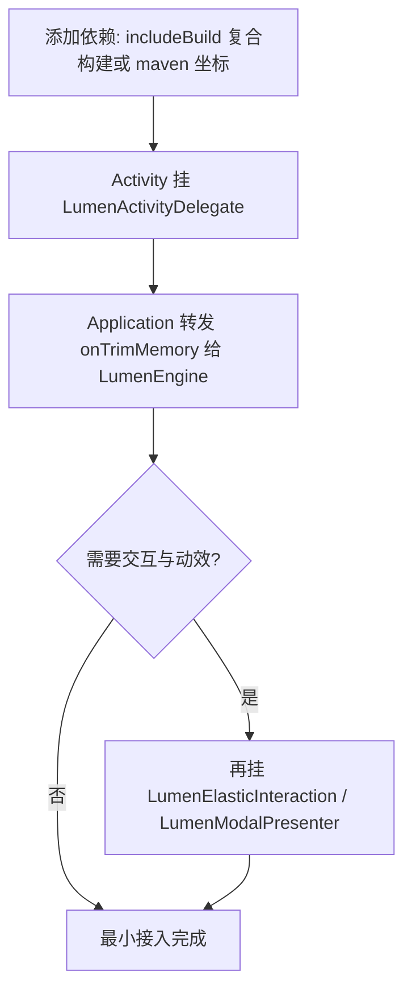

<div align="center">

# 凝光视效引擎

**Lumen Coacervation Engine**

面向 Android View 系统的可移植玻璃材质与视效引擎

<br>

**简体中文**

<br>

[](LICENSE)
[](#要求)
[](https://kotlinlang.org)
[](https://github.com/jichuo1/LumenCoacervationEngine/releases)
[](https://jitpack.io/#jichuo1/LumenCoacervationEngine)
[](https://github.com/jichuo1/LumenCoacervationEngine/issues)

**[下载 Demo / 查看最新发布](https://github.com/jichuo1/LumenCoacervationEngine/releases/latest)**

[功能](#功能) · [下载 Demo](#下载-demo) · [材质](#两套材质) · [要求](#要求) · [接入](#接入) · [文档](#文档) · [出处与许可](#出处与许可)

</div>

> [!NOTE]
> 本项目抽离自 [Bilibili Innocent Lab](https://github.com/jichuo1/Bilibili_Innocent_Lab)，以 Apache-2.0 单独授权发布。

---

## 功能

为卡片、悬浮栏、弹窗和页面提供一致的材质与交互效果。接入组件后，引擎协调表面绘制、位置采样和动画生命周期；宿主保留自己的页面内容、配色与业务交互。

<table>
<tr>
<td width="50%" valign="top">

#### 引擎本体（`lumen-engine`）

- 柔光与高级玻璃材质，多种表面角色
- 可选 Mica / Mica Alt 云母窗口背景、内容分层与失焦回退，见[云母材质](docs/MICA_MATERIAL.md)
- 局部取样区域裁剪与共享 Drawable 录制，见[小视口内容源](docs/VIEWPORT_CONTENT_SOURCE.md)和[局部会话](docs/SURFACE_SESSIONS.md)
- 悬浮栏可读性、触摸光晕
- 接入的竖向滚动回弹与材质采样同步
- 材质降级与健康回退
- 边缘高光、长按形变与光晕强度等可调参数

</td>
<td width="50%" valign="top">

#### 交互与动效（`lumen-motion`，可选）

- 长按拖动形变与触点高光
- 可打断翻页、文字链与选中框滑动
- 锚定气泡、弹窗及全屏页形变、标题迁移、预测返回
- 可选全屏形变跟随屏幕圆角、自定义皮肤跨页与面板的连续交接
- 手风琴、定位高亮、微动效
- 列表、网格、轮播及嵌套面板接入

</td>
</tr>
</table>

还可按需选择局部按压、波纹、渐进模糊、传感器光源、装饰粒子，以及 Lottie / PAG / Rive 动画播放。横向滚动保留平台行为；不同组件的接入范围见[适配标准](docs/INTEGRATION_STANDARD.md)。

---

## 下载 Demo

前往 **[最新发布页](https://github.com/jichuo1/LumenCoacervationEngine/releases/latest)**，在 Assets 中选择 `lumen-demo-<版本>.apk`。同页的校验清单可用于核对文件完整性。若安装提示签名冲突，先卸载旧 Demo。

| 页 | 可以体验 |
|:---|:---|
| 材质 | 两套材质、表面角色、控件换装、形变面板与全屏页 |
| 动效 | 可打断翻页、手风琴、档位条、选中框滑动、定位高亮 |
| 列表 | 竖向列表与网格的长按拖拽排序 |
| 排布 | 网格、混排、横向轮播、卡中卡 |
| 自适应 | 窗口变化、宽屏双栏、旋转与分屏 |
| 设置 | 深浅色、强调色、材质与采样、自定义背景及视效参数 |

示例源码见 [`sample/`](sample)。

---

## 两套材质

| 材质 | 标识 | 表现与平台 |
|:---|:---|:---|
| 柔光 | `MATERIAL_YOU` | 静态环境磨砂与悬浮表面软件透镜，支持 Android 8.1+ |
| 高级材质 | `LIQUID` | 折射与可选实时取样；Android 12+ 支持 BLUR，Android 13+ 支持 REFRACTION，按设备能力降级 |

高级材质不可用时会选择适合当前设备的后端；渲染失败时可回退柔光。细节效果与平台回退见[局部视效说明](docs/VISUAL_EFFECTS.md)。

---

## 要求

| 项 | 说明 |
|:---|:---|
| **引擎版本** | 1.5.4 |
| **运行系统** | Android 8.1+（`minSdk 27`） |
| **编译环境** | `compileSdk 37`；源码构建使用 JDK 17+ |
| **基础依赖** | 引擎本体依赖 AndroidX core；motion 不要求 AppCompat |

所有选择的 Lumen 模块使用同一版本，按功能添加即可。

| 模块 | 用途 |
|:---|:---|
| `lumen-engine` | 必需：材质、会话与表面绘制 |
| `lumen-motion` | 长按弹性、翻页、弹窗和页面动效 |
| `lumen-controls` | AppCompat 控件换装、开关识别、RecyclerView 拖拽排序与滚动停止适配 |
| `lumen-compose` | 可选原型：原生局部材质、背景来源、Lazy 生命周期与长按弹性 |
| `lumen-effects` | 薄膜、纸张、有限能量与粒子装饰 |
| `lumen-assets` | 动画资产来源、播放会话与生命周期管理 |
| `lumen-assets-lottie` | Lottie JSON 动画 |
| `lumen-assets-pag` | PAG 时间线 |
| `lumen-assets-rive` | Rive 画板、时间线与状态机输入 |

Compose 原型只覆盖上述局部能力，尚不提供完整 Activity、原生回弹、Modal 形变或预测返回接入。Rive 使用原生播放时钟，不支持固定时钟、任意寻帧或自定义速度与重复控制。选择这些模块前，可查看 [Compose 接入](docs/NATIVE_COMPOSE.md)与[效果及动画资产](docs/P2_EFFECTS_AND_ASSETS.md)。

---

## 接入



**1. 添加依赖**

```kotlin
// settings.gradle.kts
dependencyResolutionManagement {
    repositoriesMode.set(RepositoriesMode.FAIL_ON_PROJECT_REPOS)
    repositories {
        google()
        mavenCentral()
        maven { url = uri("https://jitpack.io") }
    }
}

// app/build.gradle.kts
dependencies {
    implementation("com.github.jichuo1.LumenCoacervationEngine:lumen-engine:1.5.4")
    // 按需添加，版本保持一致
    implementation("com.github.jichuo1.LumenCoacervationEngine:lumen-motion:1.5.4")
    implementation("com.github.jichuo1.LumenCoacervationEngine:lumen-controls:1.5.4")
}
```

复合构建与本地 Maven 接入见[适配标准 §1.1](docs/INTEGRATION_STANDARD.md#11-依赖方式)。

**2. 连接 Activity 生命周期**

组合式委托可用于任意 Activity 基类，示例使用宿主已有的 `AppCompatActivity`。`palette()` 和 `buildContent()` 分别代表宿主配色与页面构造；页面用 `lumen.cardBackground()` 等方法设置材质背景。

```kotlin
class MainActivity : AppCompatActivity() {
    private val lumen = LumenActivityDelegate(this, paletteProvider = { palette() })

    override fun onCreate(savedInstanceState: Bundle?) {
        super.onCreate(savedInstanceState)
        lumen.prepare()
        val root = buildContent()
        setContentView(root)
        lumen.bindRoot(root) { recreate() }
    }

    override fun dispatchTouchEvent(event: MotionEvent): Boolean {
        lumen.onDispatchTouchEvent(event)
        return super.dispatchTouchEvent(event)
    }
    override fun onStart() { super.onStart(); lumen.onStart() }
    override fun onStop() { lumen.onStop(); super.onStop() }
    override fun onTrimMemory(level: Int) { lumen.onTrimMemory(level); super.onTrimMemory(level) }
    @Deprecated("Deprecated in Java")
    override fun onLowMemory() { lumen.onLowMemory(); @Suppress("DEPRECATION") super.onLowMemory() }
    override fun onDestroy() { try { lumen.onDestroy() } finally { super.onDestroy() } }
}
```

**3. 处理进程级内存压力**

在宿主的 Application 中转发：

```kotlin
override fun onTrimMemory(level: Int) {
    super.onTrimMemory(level)
    if (level == TRIM_MEMORY_RUNNING_CRITICAL || level >= TRIM_MEMORY_COMPLETE) {
        LumenEngine.releaseGraphics()
    }
}
```

材质选择用 `LumenEngine.selectMaterial()`；长按与弹窗分别接入 `LumenElasticInteraction`、`LumenModalPresenter`。滚动、全屏页、局部会话及可选模块的完整写法见[适配标准](docs/INTEGRATION_STANDARD.md)和 [`sample/`](sample)。

---

## 文档

| 文档 | 用途 |
|:---|:---|
| [适配标准](docs/INTEGRATION_STANDARD.md) | 生命周期、滚动、手势与各场景接线 |
| [API 清单](docs/API.md) | 公开入口与参数 |
| [局部表面会话](docs/SURFACE_SESSIONS.md) | 局部材质、背景来源与位置通知 |
| [视效参数](docs/VISUAL_EFFECTS.md) | 轮廓、按压、光源、渐进模糊与平台回退 |
| [效果与动画资产](docs/P2_EFFECTS_AND_ASSETS.md) | 装饰、传感器、Lottie / PAG / Rive |
| [Compose 接入](docs/NATIVE_COMPOSE.md) | 原生局部材质与弹性原型 |
| [Fluent 亚克力与层级](docs/FLUENT_MATERIAL.md) | 控件级亚克力配方、回退规则、层级描边与阴影 |
| [文档索引](docs/README.md) | 全部文档的分类（现行 / 历史）与维护规则 |
| [更新记录](CHANGELOG.md) | 各版本变化 |

## 反馈

欢迎提交 [Issue](https://github.com/jichuo1/LumenCoacervationEngine/issues)。请附引擎版本、Android 版本与机型、复现步骤；渲染问题请注明材质，异常问题可附相关日志。

## 出处与许可

引擎抽离自 [Bilibili Innocent Lab](https://github.com/jichuo1/Bilibili_Innocent_Lab)，由原作者以 [Apache License 2.0](LICENSE) 重新授权发布，详见 [`NOTICE`](NOTICE)。来源工程保留其原有许可证。

自 1.4.6 起的视口裁剪与共享录制还吸收了 LiJiaHua1024 在来源工程 `next` 分支的贡献，已取得其同意以 Apache-2.0 纳入引擎；具体提交和归属见 [`THIRD_PARTY_NOTICES.md`](THIRD_PARTY_NOTICES.md)。

感谢来源工程、AndroidX、Kotlin，以及参与使用和反馈的开发者。

<div align="center">

<br>

**[Apache-2.0](LICENSE)** · [Issues](https://github.com/jichuo1/LumenCoacervationEngine/issues) · [Releases](https://github.com/jichuo1/LumenCoacervationEngine/releases)

</div>
